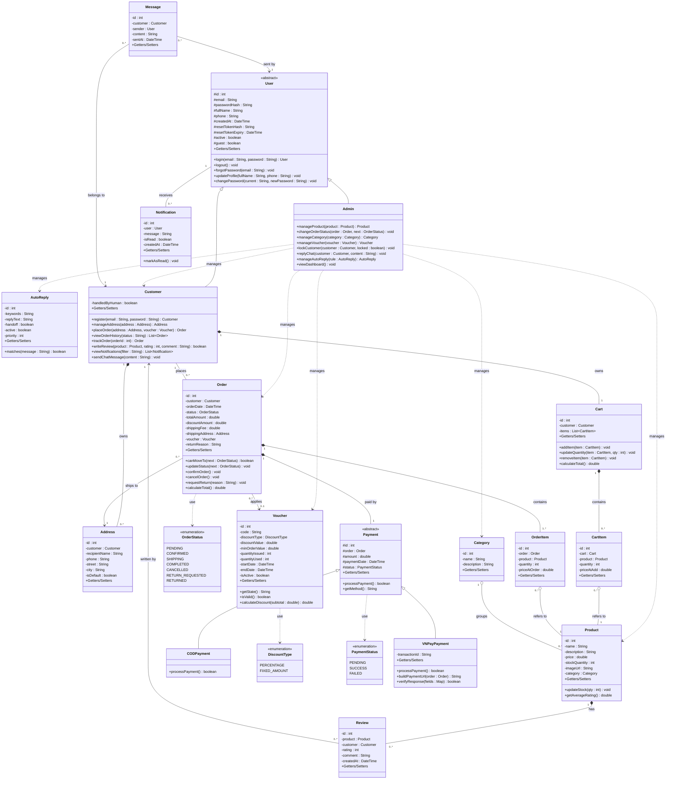

# Class Diagram hoàn chỉnh — Web Ecommerce (Core)

Quy ước visibility dùng trong toàn bộ file:
- `private` — chỉ nội bộ class dùng (mặc định cho hầu hết thuộc tính)
- `protected` — dùng ở 2 lớp cha thiết kế để kế thừa (`User`, `Payment`), cho phép class con truy cập trực tiếp field mà không cần getter
- `public` — tất cả method là API nên luôn public

Đây là bản đầy đủ có thể copy gần như nguyên trạng thành file `.java` (chỉ cần thêm phần thân method).

---

## 1. User (abstract)
```java
public abstract class User {
    protected int id;
    protected String email;
    protected String passwordHash;
    protected String fullName;
    protected String phone;
    protected Date createdAt;
    protected String resetTokenHash;   // băm SHA-256 của token quên mật khẩu (null nếu không có yêu cầu)
    protected Date resetTokenExpiry;   // hết hạn sau 30 phút
    protected boolean active = true;   // false = Admin đã khoá tài khoản (không đăng nhập được); cột users.is_active, mặc định true
    protected boolean guest = false;   // true = khách vãng lai chỉ dùng để chat (không đăng nhập được); cột users.is_guest, mặc định false

    public User login(String email, String password) { ... }      // AuthService.login
    public void logout() { ... }                                    // LogoutServlet
    public void forgotPassword(String email) { ... }                // AuthService.requestPasswordReset/resetPassword
    public void updateProfile(String fullName, String phone) { ... }          // UserService
    public void changePassword(String current, String newPassword) { ... }    // UserService
}
```

## 2. Customer extends User
```java
public class Customer extends User {
    private List<Address> addresses = new ArrayList<>();
    private List<Order> orders = new ArrayList<>();
    private Cart cart;
    private boolean handledByHuman; // true = nhân viên đang tiếp quản chat (chatbot im lặng); cột users.handled_by_human, mặc định false

    public Customer register(String email, String password) { ... }
    public Address manageAddress(Address address) { ... }
    public Order placeOrder(Address address, Voucher voucher) { ... }
    public List<Order> viewOrderHistory(String status) { ... }
    public Order trackOrder(int orderId) { ... }
    public boolean writeReview(Product product, int rating, String comment) { ... }
    public List<Notification> viewNotifications(String filter) { ... }
    public void sendChatMessage(String content) { ... }
}
```
`writeReview()` phải validate ở tầng service: chỉ cho tạo Review nếu Customer có ít nhất 1 Order chứa Product này với status `COMPLETED` (hoặc `RETURNED`). Đây là business rule, không thể hiện trong class diagram — chỉ thể hiện qua method signature.

## 3. Admin extends User
```java
public class Admin extends User {
    public Product manageProduct(Product product) { ... }
    public Category manageCategory(Category category) { ... }
    public void changeOrderStatus(Order order, OrderStatus next) { ... }
    public Voucher manageVoucher(Voucher voucher) { ... }
    public void lockCustomer(Customer customer, boolean locked) { ... }
    public void replyChat(Customer customer, String content) { ... }
    public AutoReply manageAutoReply(AutoReply rule) { ... }
    public void viewDashboard() { ... }
}
```

## 4. Address
```java
public class Address {
    private int id;
    private String recipientName;
    private String phone;
    private String street;
    private String city;
    private boolean isDefault;
    private Customer customer; // chủ sở hữu (phía giữ khoá ngoại)
}
```

## 5. Category
```java
public class Category {
    private int id;
    private String name;
    private String description;
    private List<Product> products = new ArrayList<>();
}
```

## 6. Product
```java
public class Product {
    private int id;
    private String name;
    private String description;
    private double price;
    private int stockQuantity;
    private String imageUrl;
    private Category category;
    private List<Review> reviews = new ArrayList<>();

    public void updateStock(int qty) { ... }
    public double getAverageRating() { ... } // ReviewService.summary
}
```

## 7. Cart
```java
public class Cart {
    private int id;
    private List<CartItem> items = new ArrayList<>();
    private Customer customer; // chủ giỏ hàng

    public void addItem(CartItem item) { items.add(item); }
    public void updateQuantity(CartItem item, int qty) { ... } // CartService
    public void removeItem(CartItem item) { ... }             // CartService
    public double calculateTotal() { ... }
}
```

## 8. CartItem
```java
public class CartItem {
    private int id;
    private int quantity;
    private double priceAtAdd;
    private Cart cart; // giỏ chứa dòng này
    private Product product; // aggregation — chỉ giữ reference
}
```

## 9. Order
```java
public class Order {
    private int id;
    private Date orderDate;
    private Customer customer; // người đặt (Customer 1 — 0..* Order)
    private OrderStatus status;
    private double totalAmount;
    private List<OrderItem> items = new ArrayList<>();
    private Payment payment;
    private Address shippingAddress;
    private Voucher voucher; // null nếu không dùng mã giảm giá
    private String returnReason; // null nếu không có yêu cầu hoàn hàng
    private double discountAmount; // snapshot số tiền giảm lúc đặt (voucher có thể đổi/tắt sau này)
    private double shippingFee; // snapshot phí vận chuyển lúc đặt; totalAmount = tổng hàng − discountAmount + shippingFee

    public void confirmOrder() { ... }
    public void cancelOrder() { ... } // Customer (chủ đơn) hoặc Admin đều gọi được — check quyền ở tầng service
    public boolean canMoveTo(OrderStatus next) { ... } // luật chuyển trạng thái hợp lệ (nơi duy nhất định nghĩa)
    public void updateStatus(OrderStatus next) { ... } // ném lỗi nếu !canMoveTo(next); hoàn kho do Service/DAO lo
    public double calculateTotal() { ... }
    public void requestReturn(String reason) { ... } // Customer gọi, chỉ hợp lệ khi status = COMPLETED
    // Admin duyệt hoàn (RETURN_REQUESTED -> RETURNED, hoàn kho) hoặc từ chối (-> COMPLETED) bằng updateStatus() qua AdminOrderService.changeStatus
}
```

## 10. OrderItem
```java
public class OrderItem {
    private int id;
    private int quantity;
    private Order order; // đơn chứa dòng này
    private double priceAtOrder; // snapshot giá, không đổi dù Product đổi giá sau
    private Product product; // aggregation
}
```

## 11. OrderStatus (enum)
```java
public enum OrderStatus {
    PENDING,
    CONFIRMED,
    SHIPPING,
    COMPLETED,
    CANCELLED,
    RETURN_REQUESTED, // khách yêu cầu hoàn hàng sau khi COMPLETED
    RETURNED          // admin duyệt hoàn hàng xong
}
```
Transition hợp lệ: `PENDING → CONFIRMED → SHIPPING → COMPLETED`, nhánh `PENDING/CONFIRMED → CANCELLED`, và nhánh mới `COMPLETED → RETURN_REQUESTED → RETURNED` (hoặc quay lại `COMPLETED` nếu Admin từ chối). Validate transition thực hiện trong `updateStatus()`, không phải trong enum.

## 12. Payment (abstract)
```java
public abstract class Payment {
    protected int id;
    protected double amount;
    protected Date paymentDate;
    protected PaymentStatus status;
    protected Order order; // đơn được thanh toán

    public abstract boolean processPayment();
}
```

## 13. PaymentStatus (enum)
```java
public enum PaymentStatus {
    PENDING, SUCCESS, FAILED
}
```

## 14. CODPayment extends Payment
```java
public class CODPayment extends Payment {
    @Override
    public boolean processPayment() { ... }
}
```

## 15. VNPayPayment extends Payment
```java
public class VNPayPayment extends Payment {
    private String transactionId;

    @Override
    public boolean processPayment() { ... }
}
```

## 16. Review
```java
public class Review {
    private int id;
    private int rating; // 1-5 sao
    private String comment;
    private Date createdAt;
    private Customer customer; // tác giả
    private Product product; // sản phẩm được đánh giá
}
```

---

## Bảng tổng hợp quan hệ

| Quan hệ | Loại | Multiplicity | Label trên mũi tên |
|---|---|---|---|
| User → Customer, Admin | Inheritance | — | (không ghi) |
| Payment → CODPayment, VNPayPayment | Inheritance | — | (không ghi) |
| Customer — Address | Composition | 1 — 0..* | owns |
| Customer — Cart | Composition | 1 — 1 | owns |
| Cart — CartItem | Composition | 1 — 0..* | contains |
| Order — OrderItem | Composition | 1 — 1..* | contains |
| Order — Payment | Composition | 1 — 1 | paid by |
| Product — Review | Composition | 1 — 0..* | has |
| CartItem — Product | Aggregation | 0..* — 1 | refers to |
| OrderItem — Product | Aggregation | 0..* — 1 | refers to |
| Category — Product | Aggregation | 1 — 0..* | groups |
| Customer — Order | Association | 1 — 0..* | places |
| Admin → AutoReply | Dependency | 1 — 0..* | manages (soạn luật trả lời tự động) |
| Admin → Customer | Dependency | 1 — 0..* | manages (khoá/mở tài khoản) |
| Admin → Order | Dependency | 1 — 0..* | manages (đổi trạng thái) |
| Admin → Product | Dependency | 1 — 0..* | manages (thêm/sửa/xoá) |
| Admin → Voucher | Dependency | 1 — 0..* | manages (thêm/sửa/bật tắt/xoá) |
| Admin → Category | Dependency | 1 — 0..* | manages (thêm/sửa/xoá) |

Các quan hệ `Admin → …` là phụ thuộc về mặt nghiệp vụ (các hàm `manage…` của Admin tác động lên class đó); không có khoá ngoại tới Admin trong code, nên vẽ bằng đường đứt.
| Order — Address (shippingAddress) | Association | 0..* — 1 | ships to |
| Review — Customer | Association | 0..* — 1 | written by |
| User — Notification | Association | 1 — 0..* | receives |
| Message — Customer | Association | 0..* — 1 | belongs to (khách sở hữu luồng chat) |
| Message — User | Association | 0..* — 1 | sent by |
| Order — Voucher | Association | 0..* — 0..1 | applies |
| Voucher → DiscountType | Dependency | — | `<<use>>` |
| Order → OrderStatus | Dependency | — | `<<use>>` |
| Payment → PaymentStatus | Dependency | — | `<<use>>` |

**Lưu ý về Dependency:** `OrderStatus`/`PaymentStatus` chỉ là kiểu dữ liệu (enum) mà `Order`/`Payment` dùng cho 1 thuộc tính — không phải quan hệ sở hữu/tham chiếu object như các loại kia, nên đúng chuẩn UML phải vẽ mũi tên đứt nét (Dependency, `..>`) kèm stereotype `<<use>>`, không phải Association.

## 17. Notification (mới)
```java
public class Notification {
    private int id;
    private String message;
    private boolean isRead;
    private Date createdAt;
    private User user; // người nhận
}
```
Tạo tự động mỗi khi `Order.updateStatus()` được gọi — không cần class Order gọi trực tiếp constructor, có thể tách 1 service riêng `NotificationService` để lo việc này (không cần class diagram thể hiện service layer).

## 18. Message (mới)
```java
public class Message {
    private int id;
    private String content;
    private Date sentAt;
    private Customer customer; // khách sở hữu luồng chat (mọi tin của khách lẫn shop đều gắn với 1 khách)
    private User sender; // Customer hoặc Admin (đa hình); chatbot dùng 1 tài khoản hệ thống loại Admin
}
```
`sender` không lưu field riêng `isAdmin` hay tương tự — chỉ cần tham chiếu kiểu `User`, polymorphism tự lo việc phân biệt Customer hay Admin gửi.

**Không có class `Conversation` và `AIBot`:** mỗi `Message` gắn trực tiếp với khách qua `customer` (khách chỉ thấy tin có `customer` là mình, Admin lọc theo khách). Chatbot trả lời bằng một tài khoản hệ thống loại `Admin` ("Trợ lý AI"); logic gọi API AI (OpenAI/Anthropic...) nằm ở tầng Service (`ChatBotService.generateReply(...)`), không thể hiện trong class diagram.

## 19. Voucher (mới)
```java
public class Voucher {
    private int id;
    private String code;
    private DiscountType discountType;
    private double discountValue;
    private double minOrderValue;
    private int quantityIssued;
    private int quantityUsed;
    private Date startDate;
    private Date endDate;
    private boolean isActive;

    public String getState() { ... } // active|expired|soldout|off — nơi duy nhất định nghĩa điều kiện
    public double calculateDiscount(double subtotal) { ... } // VoucherService
    public boolean isValid() { ... } // state == active; check startDate <= now <= endDate, isActive, quantityUsed < quantityIssued
}
```

## 20. DiscountType (mới, enum)
```java
public enum DiscountType {
    PERCENTAGE, FIXED_AMOUNT
}
```

## 21. AutoReply (mới)
```java
public class AutoReply {
    private int id;
    private String keywords;   // các từ khoá/cụm từ cách nhau bằng dấu phẩy; "*" (đứng một mình) = khớp mọi câu
    private String replyText;  // câu chatbot trả lời
    private boolean handoff;   // true = sau khi trả lời chuyển cuộc trò chuyện sang nhân viên
    private boolean isActive;
    private int priority;      // số nhỏ được xét trước; luật đầu tiên khớp thắng

    public List<String> getKeywordList() { ... }
}
```
Luật trả lời tự động do Admin soạn ở CMS (Admin > Trả lời tự động); `ChatBotService` đọc các luật đang bật theo `priority` và chọn luật đầu tiên có từ khoá khớp (khớp nguyên từ, không phân biệt hoa thường/dấu). Không quan hệ với entity nào khác.

---

## Đối chiếu hàm trên sơ đồ ↔ code thật (`docs/class-diagram.drawio`)

Nguyên tắc vẽ: mỗi hàm chỉ đặt ở class sở hữu dữ liệu đó, không lặp lại hàm kế thừa (Admin dùng `login/logout` của User) và không liệt kê getter đơn thuần. Trong code, hàm nghiệp vụ nằm ở lớp Service; entity giữ luật nhỏ.

| Class | Hàm trên sơ đồ | Nằm ở đâu trong code |
|---|---|---|
| User | `login`, `forgotPassword` | `AuthService.login`; `AuthService.requestPasswordReset/resetPassword`; `logout` = `LogoutServlet` |
| User | `updateProfile`, `changePassword` | `UserService.updateProfile/changePassword` (app chỉ mở trang hồ sơ cho Customer) |
| Customer | `register` | `AuthService.register` |
| Customer | `manageAddress` | `AddressService.create/update/setDefault/delete` |
| Customer | `placeOrder` | `OrderService.checkout` |
| Customer | `viewOrderHistory`, `trackOrder` | `OrderService.getOwnHistory/getOwnOrder` |
| Customer | `writeReview` | `ReviewService.write` |
| Customer | `viewNotifications` | `NotificationService.getOwn` |
| Customer | `sendChatMessage` | `ChatService.sendFromCustomer` |
| Admin | `manageProduct` | `AdminProductService.save/delete` |
| Admin | `manageCategory` | `AdminCategoryService.save/delete` |
| Admin | `changeOrderStatus` | `AdminOrderService.changeStatus` → `Order.canMoveTo/updateStatus` |
| Admin | `manageVoucher` | `AdminVoucherService.save/setActive/delete` |
| Admin | `lockCustomer` | `AdminCustomerService.setLocked` |
| Admin | `replyChat` | `AdminChatService.send/setHuman` |
| Admin | `manageAutoReply` | `AdminAutoReplyService.save/setActive/delete/test` |
| Admin | `viewDashboard` | `AdminStatsService` |
| Cart | `addItem`, `calculateTotal` | entity `Cart` |
| Cart | `updateQuantity`, `removeItem` | `CartService.updateQuantity/removeItem` |
| Order | `canMoveTo`, `updateStatus`, `confirmOrder`, `cancelOrder`, `requestReturn`, `calculateTotal` | entity `Order` (khách huỷ/hoàn qua `OrderService.cancelOwnOrder/requestOwnReturn`) |
| Voucher | `getState`, `isValid`, `calculateDiscount` | entity `Voucher`; `VoucherService.calculateDiscount` |
| Product | `updateStock`, `getAverageRating` | entity `Product`; `ReviewService.summary` |
| Notification | `markAsRead` | `NotificationService.markOwnRead` |
| AutoReply | `matches` | `ChatBotService.match` |
| Payment / COD / VNPay | `processPayment`, `getMethod`; VNPay thêm `buildPaymentUrl`, `verifyResponse` | entity `Payment`; `VNPayService` |

Khách vãng lai (Unregistered Customer: xem/tìm sản phẩm, chi tiết, đăng ký, chat vãng lai) không có class riêng — dùng `ProductService`, `AuthService.register`, `ChatService.startGuest`.

---

## Phần Optional còn lại (chưa đưa vào diagram)

- `Wishlist` — quan hệ nhiều-nhiều `Customer` — `Product`, model như Aggregation qua bảng trung gian, label: `saves`

---

## Mermaid source (paste vào mermaid.live để export ảnh/svg cho báo cáo)


